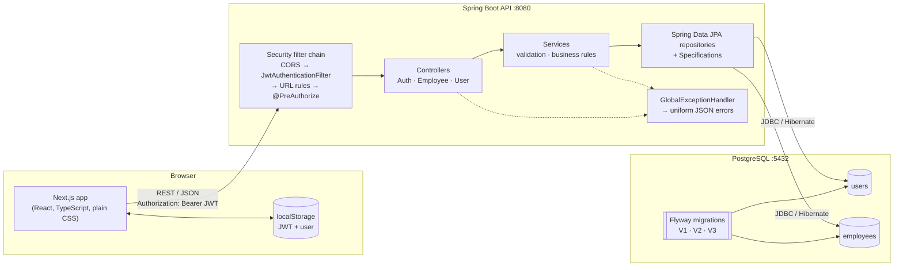
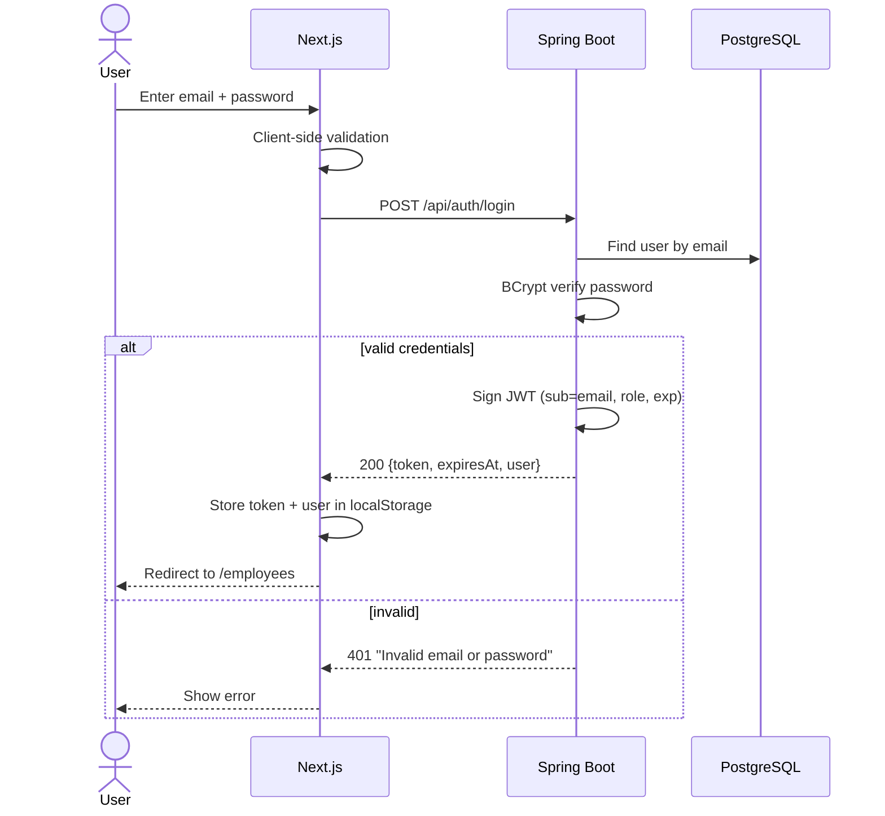
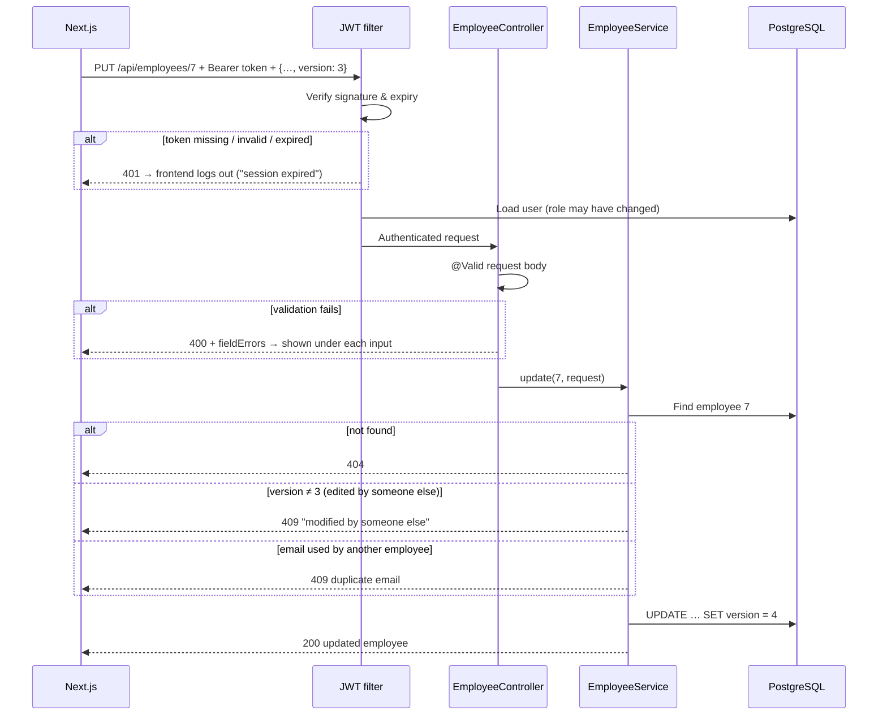
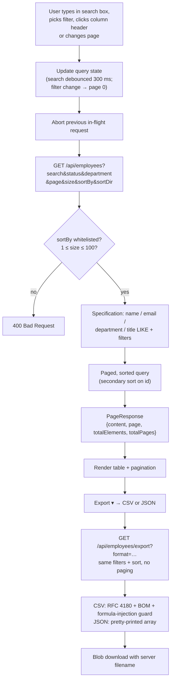
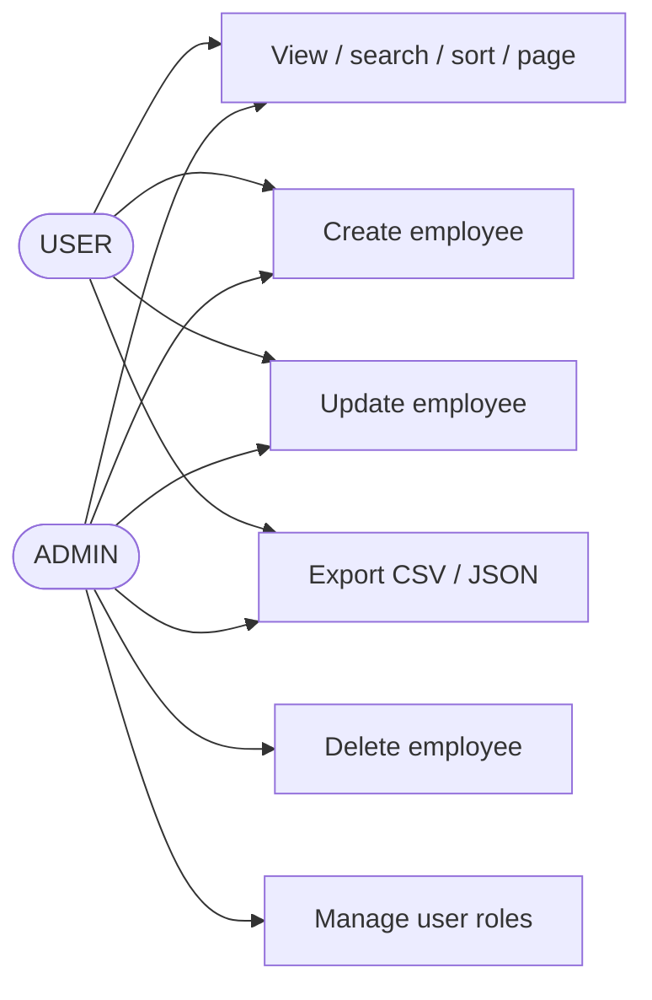

# Employees CRUD in Java

A full-stack employee management application:

- **Backend:** Java 21, Spring Boot 3.5, Spring Data JPA, Spring Security with JWT, Flyway
- **Database:** PostgreSQL 16
- **Frontend:** Next.js 15 (React 19, TypeScript), plain CSS with no UI framework

Signed-in users can create, view, update, search, sort, paginate, and export (CSV/JSON) employee records. Only **admins** can delete employees and change user roles.

See [docs/DESIGN.md](docs/DESIGN.md) for design decisions and assumptions.

---

## Architecture



| Layer | Responsibility |
|-------|----------------|
| **Next.js frontend** | Pages for login, register, employees and users. `lib/api.ts` attaches the JWT and turns error responses into `ApiError`. `lib/auth.tsx` holds the session. Client-side validation mirrors the server's. |
| **Security filter chain** | CORS check. `JwtAuthenticationFilter` verifies the token and loads the user from the database. URL rules require authentication, and `@PreAuthorize` restricts admin-only actions. 401/403 responses are JSON. |
| **Controllers** | Map HTTP to service calls, run Bean Validation on request DTOs (`@Valid`), and set status codes (201 + `Location`, 204). |
| **Services** | Business rules: email uniqueness, sort-field whitelist, page bounds, optimistic-lock check, last-admin protection. |
| **Repositories** | Spring Data JPA. `EmployeeSpecifications` builds search and filter predicates shared by the list and export endpoints. |
| **PostgreSQL + Flyway** | Flyway owns the schema. Hibernate only validates against it (`ddl-auto: validate`). Constraints back up the service-level rules. |

---

## Flows

### Authentication



### Authenticated request (e.g. update an employee)



### Employee table: search, sort, paginate, export



### Role permissions



---

## Quick start (Docker)

Prerequisite: Docker with Compose v2.

### 1. Configure secrets

No passwords or keys are committed to this repository. Create a `.env` file in the project root from the template and fill it in. The values for the demo setup are **shared separately**; alternatively, generate your own with `openssl rand -base64 48`.

```bash
cp .env.example .env
# then edit .env: DB_PASSWORD, JWT_SECRET, SEED_ADMIN_PASSWORD, SEED_USER_PASSWORD
```

`.env` is git-ignored. Docker Compose refuses to start and names the missing variable if any required value is empty.

### 2. Start the stack

```bash
docker compose up -d --build
```

| Service  | URL                                   |
|----------|---------------------------------------|
| Web app  | http://localhost:3000                 |
| REST API | http://localhost:8080/api             |
| Health   | http://localhost:8080/actuator/health |
| Postgres | localhost:5432 (database and user `employees`, password from `.env`) |

If port 5432 is already in use, start with `DB_PORT=5433 docker compose up -d --build`.

### Accounts

On first start the backend creates an **admin** account (`SEED_ADMIN_EMAIL`) and a **user** account (`SEED_USER_EMAIL`) with the passwords from `.env`. Accounts are seeded only once, so changing the passwords later requires `docker compose down -v` to reset the database.

You can also create a new account from the **Create one** link; self-registered accounts get the `USER` role. The database is seeded with 25 sample employees by a Flyway migration.

To stop the stack: `docker compose down`. To also wipe the database: `docker compose down -v`.

---

## Running locally without Docker

Prerequisites: JDK 21, Node.js 20+, and a PostgreSQL 14+ instance. Maven is not required; the Maven wrapper is included.

### 1. Database

Create the database and user, or run just the DB container with `docker compose up -d db`:

```sql
CREATE USER employees WITH PASSWORD '<your DB_PASSWORD>';
CREATE DATABASE employees OWNER employees;
```

Flyway creates the schema automatically when the backend starts.

### 2. Backend (port 8080)

Export the variables from your `.env` first, then start the backend:

```bash
set -a; source ../.env; set +a      # bash/zsh: loads DB_PASSWORD, JWT_SECRET, SEED_* …
cd backend
./mvnw spring-boot:run              # Windows: mvnw.cmd spring-boot:run
```

Configuration comes from environment variables, defined in `backend/src/main/resources/application.yml`. Secrets have **no defaults**: the backend fails to start without `JWT_SECRET` and `DB_PASSWORD`.

| Variable                 | Default                                       | Purpose                                   |
|--------------------------|-----------------------------------------------|-------------------------------------------|
| `DB_URL`                 | `jdbc:postgresql://localhost:5432/employees`  | JDBC URL                                  |
| `DB_USERNAME`            | `employees`                                   | DB user                                   |
| `DB_PASSWORD`            | **required**                                  | DB password                               |
| `JWT_SECRET`             | **required**                                  | Base64 HMAC key, at least 256 bits        |
| `JWT_EXPIRATION_MINUTES` | `120`                                         | Token lifetime                            |
| `CORS_ALLOWED_ORIGINS`   | `http://localhost:3000`                       | Comma-separated list of browser origins   |
| `SEED_ADMIN_EMAIL` / `SEED_ADMIN_PASSWORD` | `admin@pesira.com` / *none*  | Admin account, seeded only if a password is set |
| `SEED_USER_EMAIL` / `SEED_USER_PASSWORD`   | `user@pesira.com` / *none*   | User account, seeded only if a password is set  |

To generate a secret, run `openssl rand -base64 48`.

### 3. Frontend (port 3000)

```bash
cd frontend
cp .env.example .env.local     # NEXT_PUBLIC_API_URL=http://localhost:8080
npm install
npm run dev
```

Open http://localhost:3000.

---

## Tests

```bash
cd backend
./mvnw test
```

The tests need no `.env`: they use throwaway, test-only values from `src/test/resources/application-test.yml`. The 26 tests cover:

- **API integration tests:** the full Spring context with the real security filter chain and real JWTs, run against in-memory H2 in PostgreSQL mode after the **real Flyway migrations** are applied. They cover auth, role checks, validation, paging, sorting, search, optimistic locking, status codes and export.
- **Unit tests:** CSV escaping and formula-injection protection.

The frontend can be type-checked with `npm run typecheck`.

---

## REST API

Every endpoint except login, register and health requires `Authorization: Bearer <token>`.

| Method | Path                              | Role  | Description |
|--------|-----------------------------------|-------|-------------|
| POST   | `/api/auth/login`                 | —     | `{email, password}` → `{token, expiresAt, user}` |
| POST   | `/api/auth/register`              | —     | `{fullName, email, password}` → 201, account gets the USER role |
| GET    | `/api/auth/me`                    | any   | Current user |
| GET    | `/api/employees`                  | any   | Paged list. Query: `search`, `status`, `department`, `page` (0-based), `size` (1–100), `sortBy`, `sortDir` (`asc`/`desc`) |
| GET    | `/api/employees/{id}`             | any   | Single employee |
| POST   | `/api/employees`                  | any   | Create → **201** + `Location` header |
| PUT    | `/api/employees/{id}`             | any   | Update. Send `version` to detect concurrent edits (**409** if stale) |
| DELETE | `/api/employees/{id}`             | ADMIN | Delete → **204** |
| GET    | `/api/employees/export`           | any   | `format=csv\|json` plus the same filters and sort as the list. Returns a file download |
| GET    | `/api/employees/departments`      | any   | Distinct departments (used by the filter dropdown) |
| GET    | `/api/users`                      | ADMIN | List users |
| PATCH  | `/api/users/{id}/role`            | ADMIN | `{role: "ADMIN"\|"USER"}`. The last admin cannot be demoted |

Sortable fields: `id, firstName, lastName, email, department, jobTitle, salary, hireDate, status, createdAt`.

### Status codes and error format

| Code | When |
|------|------|
| 200 / 201 / 204 | Success (read or update / create / delete) |
| 400 | Validation failure, malformed JSON, bad query parameter (e.g. unknown sort field) |
| 401 | Missing, invalid or expired token; wrong credentials |
| 403 | Authenticated but lacks the required role |
| 404 | Record not found |
| 409 | Duplicate email, or stale `version` on update |
| 500 | Unexpected error (details are logged, not returned) |

Every error response uses the same body:

```json
{
  "timestamp": "2026-10-15T11:53:36.698Z",
  "status": 400,
  "error": "Bad Request",
  "message": "Validation failed",
  "path": "/api/employees",
  "fieldErrors": { "email": "Email must be valid", "salary": "Salary cannot be negative" }
}
```

### Example

```bash
set -a; source .env; set +a        # loads SEED_ADMIN_EMAIL / SEED_ADMIN_PASSWORD
TOKEN=$(curl -s localhost:8080/api/auth/login -H 'Content-Type: application/json' \
  -d "{\"email\":\"$SEED_ADMIN_EMAIL\",\"password\":\"$SEED_ADMIN_PASSWORD\"}" | sed 's/.*"token":"\([^"]*\)".*/\1/')

curl -s "localhost:8080/api/employees?search=engineer&sortBy=salary&sortDir=desc&size=5" \
  -H "Authorization: Bearer $TOKEN"

curl -s -OJ "localhost:8080/api/employees/export?format=csv&department=Finance" \
  -H "Authorization: Bearer $TOKEN"
```

---

## Database migrations

Located in `backend/src/main/resources/db/migration`:

| Version | File | Purpose |
|---------|------|---------|
| V1 | `V1__create_users_table.sql` | `users` table, unique email, role check constraint |
| V2 | `V2__create_employees_table.sql` | `employees` table with constraints, indexes and a `version` column for optimistic locking |
| V3 | `V3__seed_sample_employees.sql` | 25 sample employees |

Hibernate runs with `ddl-auto: validate`, so it never changes the schema. All schema changes go through Flyway.

---

## Project structure

```
backend/
  src/main/java/com/pesira/employees/
    auth/        login, register, me
    bootstrap/   seeds demo admin and user accounts
    common/      error model, exception handler, page envelope
    config/      security and CORS
    employee/    entity, repository, specifications, service, controller
      export/    CSV/JSON export
    security/    JWT service and filter, JSON 401/403 handlers
    user/        user entity, admin user management
  src/main/resources/db/migration/   Flyway scripts
frontend/
  src/app/         pages: login, register, employees, users
  src/components/  table, pagination, form modal, dialogs, export menu
  src/lib/         API client, auth context, validation, formatting
docs/DESIGN.md     design decisions and assumptions
docker-compose.yml
```
